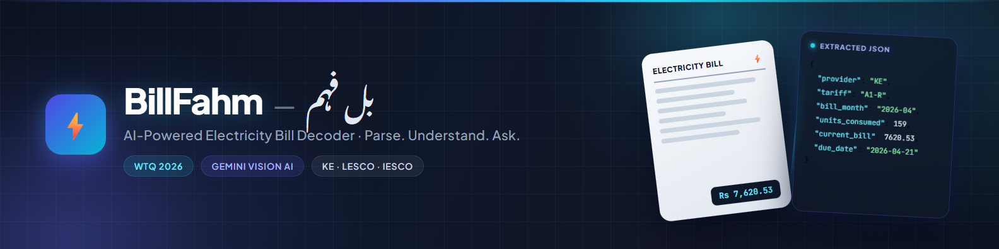

<div align="center">



# BillFahm — بل فہم

### AI-Powered Electricity Bill Decoder · WTQ 2026

**Upload a photo of your electricity bill → get structured data back → ask questions about it in plain English.**

[](https://utility-bill-decoder-wtq-2026.vercel.app/)


</div>

---

## 📖 Overview

**BillFahm** (بل فہم — *"bill understanding"*) decodes Pakistani electricity bills from **K-Electric (KE), LESCO, and IESCO** using Google Gemini vision AI. A single PNG/JPG upload is transformed into a strict, standardized 18-field JSON schema — and users can then ask natural-language questions about their bill and receive precise, grounded answers.

Built for **Women Tech Quest (WTQ) 2026 — Build Track**, it ships as a full-stack web application: a FastAPI backend deployed on Vercel serverless functions, a responsive bilingual UI, and a batch-processing pipeline for large-scale extraction and Q&A runs.

## ✨ Features

### Level 1 — Intelligent Bill Extraction
- Upload any KE / LESCO / IESCO bill image (PNG, JPG, JPEG up to 4 MB)
- Extracts **18 standardized fields**: provider, tariff, sanctioned load, bill month, reading/issue/due dates, meter readings, units consumed, itemized charges & taxes, totals, arrears, and payable amounts
- Strict JSON schema enforcement — all keys always present, credits/subsidies normalized to negative numbers, zero-amount lines filtered, provider names canonicalized
- Batch pipeline (`run_train_level1.py`, `source/main.py`) processes entire bill directories to CSV + JSON

### Level 2 — Grounded Question Answering
- Ask anything about the bill: *"How much of my bill is taxes?"*, *"What is my sanctioned load?"*, *"Which months went above 200 units?"*
- Answers are grounded **only** in the bill image and extracted JSON — no external tariff tables, no hallucinated numbers
- Precise arithmetic on history tables, estimates explicitly labeled, personal identifiers always excluded

### Web Application
- Clean dark-themed UI with **bilingual branding** (BillFahm — بل فہم, proper RTL Nastaliq typography)
- Live bill preview, extraction results table, and an interactive chat panel
- Pre-extracted JSON cache per bill for instant reloads

### Production-Grade Engineering
- **Serverless-ready** FastAPI on Vercel with native API functions and request-path recovery middleware
- **Lazy AI client initialization** — a missing API key returns a clean `503 missing_config` instead of crashing the function
- **Classified error handling** — every failure maps to a coded, human-readable message (`unsupported_file`, `file_too_large`, `timeout`, `rate limit`, `api_failure`, `not_found`) — never a raw stack trace or "Unknown error"
- **Secret redaction** in all error paths (API keys and bearer tokens scrubbed from messages)
- **Rate-limit resilience** with exponential backoff retries, tuned shorter on serverless to respect function timeouts
- Input validation: file extension + MIME + size enforced server-side (PDFs rejected with a clear message)

##  API Endpoints

| Method | Endpoint | Description |
|--------|----------|-------------|
| `GET` | `/` | Web UI |
| `POST` | `/api/extract` | Extract Level 1 JSON from an uploaded image or existing `rel_path` |
| `POST` | `/api/ask` | Answer a natural-language question about an extracted bill |
| `GET` | `/api/health` | Service status + Gemini configuration state |
| `GET` | `/api/status` | Row counts and submission availability |
| `GET` | `/api/bills` | List available sample bills |
| `GET` | `/api/image` | Serve a bill image by relative path (path-traversal safe) |
| `GET` | `/api/extracted-json/{bill_id}` | Fetch cached extraction JSON |
| `GET` | `/api/download/submission` | Generate & download the submission zip |

## 🛠️ Tech Stack

| Layer | Technology |
|-------|------------|
| Language | Python 3.12+, JavaScript, HTML5/CSS |
| Backend | FastAPI, Pydantic, Uvicorn |
| AI | Google Gemini API (`google-genai`) — vision + text |
| Frontend | Tailwind CSS, Noto Nastaliq Urdu (RTL), Plus Jakarta Sans |
| Deployment | Vercel Serverless Functions (Python runtime) |
| Data | JSON schema pipeline, CSV batch outputs |
| Testing | `unittest` + FastAPI TestClient (11 tests) |

## 📁 Project Structure

```text
WTQ-2026/
├── app.py                     # Local launcher (uvicorn)
├── vercel.json                # Serverless function config (maxDuration)
├── pyproject.toml             # Vercel entrypoint → source.app:app
├── api/                       # Native Vercel function wrappers
│   ├── extract.py · ask.py · status.py · health.py · bills.py
├── source/
│   ├── app.py                 # FastAPI app: routes, middleware, validation
│   ├── config.py              # Prompts, schema, env loading
│   ├── errors.py              # Error classification + secret redaction
│   ├── level1_extractor.py    # Gemini bill → structured JSON
│   ├── level2_qa.py           # Grounded question answering
│   ├── main.py                # Batch pipeline + submission zip
│   └── static/index.html      # Web UI
├── tests/test_extract_api.py  # Routing, validation, error, redaction tests
├── run_train_level1.py        # Batch extraction runner
├── extract_bill.py            # Single-bill CLI extractor
├── verify_results.py          # Output audit/verification
├── test/ · train/             # Bill images + CSV templates (gitignored)
└── output/                    # Generated CSV/JSON results (gitignored)
```

## 🚀 Getting Started

### 1. Clone the repository

```bash
git clone https://github.com/arhama1100/utility-bill-decoder-wtq-2026.git
cd utility-bill-decoder-wtq-2026
```

### 2. Create and activate a virtual environment

```bash
python -m venv .venv
.venv\Scripts\Activate.ps1      # Windows PowerShell
```

### 3. Install dependencies

```bash
pip install -r requirements.txt
```

### 4. Configure your API key

Copy `source/.env.example` to `.env` in the project root and add your [Google Gemini API key](https://aistudio.google.com/apikey):

```env
GEMINI_API_KEY=your-gemini-api-key-here
MODEL_NAME=gemini-3.5-flash-lite   # optional
```

> 🔒 Never commit your real `.env` — it is already gitignored.

### 5. Run locally

```bash
python app.py
```

Open **http://127.0.0.1:8000** and upload a bill image.

### 6. Run tests

```bash
python -m unittest tests.test_extract_api -v
```

## 📊 Output Format

Every bill is normalized to this schema (all 18 keys always present; `null` when unreadable — never guessed):

```json
{
  "provider": "KE",
  "tariff": "A-1a(01)",
  "sanctioned_load_kw": 3,
  "bill_month": "2026-04",
  "reading_date": "2026-04-03",
  "issue_date": "2026-04-07",
  "due_date": "2026-04-21",
  "previous_reading": 12345,
  "current_reading": 12504,
  "units_consumed": 159,
  "charges": [{ "type": "energy", "amount": 4521.75 }],
  "total_charges": 4521.75,
  "taxes": [{ "type": "gst", "amount": 750.2 }],
  "total_taxes": 985.3,
  "current_bill": 7620.53,
  "arrears": 0,
  "payable_within_due_date": 7620,
  "payable_after_due_date": 8001
}
```

## 🔒 Security & Privacy

- All personal identifiers (names, addresses, CNIC, account/reference/meter numbers) are **excluded** from extraction and answers by design
- API keys and bearer tokens are **redacted** from every error message
- Image serving is path-traversal safe; uploads are type- and size-validated
- Use bills with personal details removed when sharing demonstrations

## ☁️ Deployment

Deployed on **Vercel** with the Python runtime:
- `pyproject.toml` declares the entrypoint (`source.app:app`); `vercel.json` sets function `maxDuration`
- Native functions under `api/` receive `/api/*` traffic; middleware recovers the original request path when Vercel collapses it
- Set `GEMINI_API_KEY` in the Vercel project's Production environment variables
- On serverless: the 3.5 s Q&A pacing sleep is skipped and retries are shortened to fit the function timeout

## 🎯 Project Context

Developed as part of **Women Tech Quest (WTQ) 2026 — Build Track**. The project automates bill processing for Pakistani electricity consumers: no more manual transcription of meter readings, charges, and due dates — take a picture and *understand* your bill.

## 👩‍💻 Author

**Arhama** · GitHub: [@arhama1100](https://github.com/arhama1100)

## 📌 Roadmap

- [ ] Improve extraction accuracy across more bill layout variants
- [ ] Cross-field validation (e.g., charges sum ≈ total bill) with confidence flags
- [ ] Support additional utility providers (MEPCO, PESCO, HESCO, QESCO)
- [ ] Urdu-language Q&A responses
- [ ] Published evaluation metrics on the full test set

---

*BillFahm is intended for learning, experimentation, and structured document processing. Always verify extracted values against the original bill before relying on them.*
